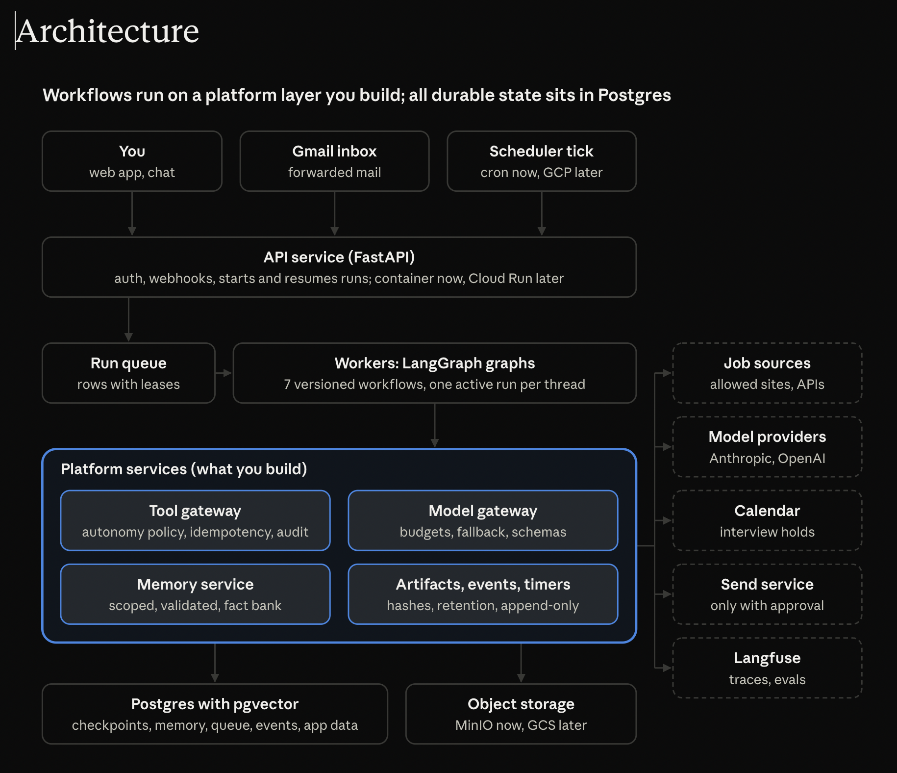

# Platform design: job search on an AI workflow platform

Oct 29, 2026 · @Yhemmy

## Goals and metric

A job-search assistant built on a reusable AI workflow platform: it finds and captures good-fit jobs, prepares applications for you to review, tracks every application from forwarded emails, and builds interview prep from what you actually submitted. It is the test workload for the plan; the platform underneath is the real deliverable.

**North-star metric:** interviews landed per week.

**Secondary metrics:**

- Application-to-interview rate, by CV version and role type
- Time from posting seen to application submitted
- Prep pack ready on the day an interview is booked
- Share of drafts you accept unchanged, per draft type

**Goals:**

- Never lose a job description or a submitted document for a job you care about
- Remove admin work: tracking, reminders, stage updates
- Raise tailoring quality without inventing anything about you
- Keep workflow definitions separate from the execution layer, so a new workflow runs without changing platform code

**Non-goals:**

- Auto-applying or sending anything in your name
- Scraping sites that forbid it; sources are those whose terms allow automated reading, or email alerts
- Multiple tenants in v1; peers come later
- A polished product: it is a test workload, and features are added only when a subsystem needs them

## Workflows

Seven workflows run on the platform, plus one held back to test it. The application is the central record: everything attaches to it.

| # | Workflow | Trigger | What it does | Ends when |
| --- | --- | --- | --- | --- |
| 1 | Scout | Daily at 07:00 | Fetches postings from allowed sources and job-alert emails, dedupes, enriches in parallel (company, sponsorship, location, closing date), scores fit, auto-captures postings above the fit threshold, sends a digest | Digest sent |
| 2 | Capture | You pick a posting, or Scout's threshold | Snapshots the job description (text, page HTML, PDF render, URL, time, hash); creates the application; opens its chat session | Application created |
| 3 | Application pack | Application created | Before you look: picks the base CV, drafts tailoring, a cover note and answers to common questions, flags fit gaps, builds a company brief, suggests referral contacts and drafts the ask | Pack ready for review |
| 4 | Workspace | You open the application | Chat-led: you refine the pack, add details, approve final versions; you submit externally, then upload or confirm exactly what you sent, which is locked as the submission | Submission confirmed |
| 5 | Tracker | Submission confirmed | Long-running: reads forwarded recruiter emails, updates the stage when confident and asks when not, drafts follow-ups at the right time, adds calendar holds for interviews, flags no reply after 21 days | Offer, rejection, withdrawal or no reply |
| 6 | Prep and debrief | Interview stage detected | Builds a prep pack from the snapshot, the submitted documents and the chat history; runs drills; prompts a debrief the same evening; updates your weak areas across all applications | Stage closed |
| 7 | Funnel review | Weekly, Sunday | Reports which CV versions, roles and companies turn into interviews; suggests changes; retunes Scout from your picks and skips | Report sent |
| 8 | Held back | Week 22 | An unfamiliar workflow from someone else, to prove the platform runs it without changing execution code | Not designed in advance |

**Application lifecycle:** picked, pack ready, in workspace, submitted, waiting, interviewing (stage 1 to n), then offer, rejected, withdrawn or no reply.

## Autonomy policy

Anything internal and reversible is automated; anything that leaves the system in your name waits for you. The policy lives in the tool gateway, so every action is checked against it, not trusted to a prompt.

| Level | Name | Meaning |
| --- | --- | --- |
| 0 | Suggest | Produces a draft or recommendation; changes nothing |
| 1 | Act internally, notify | Changes the system's own records, reversibly, and tells you |
| 2 | Act externally with approval | Prepares an external action; runs only after you approve that exact version |
| 3 | Act externally alone | Not used in v1 |

| Action | Level | Notes |
| --- | --- | --- |
| Fetch, dedupe, score postings | 1 | Read-only on the outside world |
| Snapshot a job description | 1 | Auto above the fit threshold; unpicked snapshots deleted after 30 days |
| Draft CV tailoring, cover note, answers | 0 | Every claim must trace to the fact bank |
| Build company brief, suggest referral contacts | 0 | Uses only sources whose terms allow it |
| Update stage from a forwarded email | 1 | Auto when confidence is at or above the threshold; otherwise asks you |
| Add a calendar hold for an interview | 1 | On your own calendar only |
| Send a follow-up or referral message | 2 | Drafted at the right time; sent from your account only after you approve it |
| Submit an application | Not allowed | You submit outside the system, then confirm |
| Withdraw, decline, accept | Not allowed | Yours alone |

**Earned autonomy:** the platform records how often each draft type is accepted unchanged. If a type stays at or above 90% over 4 weeks, it proposes raising its level; you decide. Levels are configuration, not code.

## Architecture



Every call to the outside world leaves through the tool or model gateway; dashed boxes are external services, and the shaded block is the platform you build and contribute from.

## Components and infrastructure

Runs on your own server first with Docker Compose, then moves to GCP in one session after gate G1 (week 7). One Postgres holds all state, and LangGraph is self-hosted so its internals stay visible.

| Component | On your server (weeks 0 to 6) | After migration | Why |
| --- | --- | --- | --- |
| Web app | Next.js container; Google sign-in over HTTPS via Tailscale or a Cloudflare Tunnel | Cloud Run | Chat per application, application views, digest |
| API | FastAPI container | Cloud Run | Auth, routes, webhooks, starts and resumes runs |
| Workflow runtime | LangGraph worker containers | Cloud Run worker service, min 1 instance | The project you contribute to; self-hosted to learn its internals |
| Run queue | Postgres table with leases (SKIP LOCKED) | Same | Week 2 concepts built for real; one fewer service |
| Checkpoints | LangGraph Postgres checkpointer | Same | Durable state per thread |
| Timers and schedules | Timers table plus a cron container calling the tick endpoint every minute | Cloud Scheduler calling the same endpoint | LangGraph has no durable timer of its own; verify in week 1 |
| Database | Postgres 16 with pgvector; nightly pg\_dump off the server, with a restore test | Cloud SQL Postgres with pgvector | App tables, checkpoints, memory store, queue, timers, events, audit in one place |
| Memory | LangGraph store on Postgres with a vector index, behind your memory service | Same | Scoped, validated memory |
| Artifacts | Cloud Storage from day one: a staging bucket (30-day expiry) and a records bucket (versioning, per-object retention); the app account has no delete on records; hashes in Postgres | Same | Snapshots and submissions can't be altered |
| Email intake | Dedicated Gmail address; Gmail API watch to a Pub/Sub topic in GCP, pulled by your server | Same, pushed to the API | Forwarded recruiter mail and job alerts |
| Model gateway | Internal module with Anthropic and OpenAI adapters on the main path, an OpenRouter adapter for eval sweeps; provider and model per step in config; fallback across providers | Same | Budgets, retries, schema repair and provider choice in one place |
| Web fetch and render | httpx, plus Playwright in a separate job container | Cloud Run job | Snapshots as text, HTML and PDF |
| Tracing and evals | OpenTelemetry to Langfuse, set up in week 19 (self-hosted with a GCS bucket, or Langfuse Cloud); eval datasets in Langfuse plus pytest | Same | Your secondary open-source project |
| Calendar | Google Calendar API | Same | Interview holds on your calendar |
| Secrets | Environment variables from an untracked .env file | Secret Manager, injected as environment variables | No code change at migration |
| Deploy and CI | Docker Compose; GitHub Actions | Terraform; GitHub Actions | Standard production setup |

Four seams keep the migration a config change:

- Storage sits behind one interface, backed by GCS from day one, using Application Default Credentials and never a key file
- Config and secrets come only from environment variables
- The scheduler is only an HTTP call to the tick endpoint
- Separate Gmail tokens: the worker gets read-only and calendar scopes, the send service alone gets send scope

## Data model

Everything you might need at interview time is immutable once recorded; changes create new versions or new events, never edits.

| Entity | Key fields | Changes? |
| --- | --- | --- |
| Fact | id, kind (role, project, metric, skill, education), text, evidence link, verified\_at | Edited by you only; history kept |
| Posting | id, source, url, dedupe\_key, title, company, fit\_score, seen\_at, expires\_at | Replaced daily; deleted after 30 days unless captured |
| JD snapshot | id, posting\_id, text, html\_uri, pdf\_uri, url, captured\_at, sha256 | Never |
| Application | id, snapshot\_id, company, role, stage, opened\_at, closed\_at, outcome, thread\_id, chat\_thread\_id | Stage, outcome and notes only |
| Document | id, kind (cv, cover\_note, answers), version, parent\_version, uri, sha256, created\_by (you or draft) | Never; an edit is a new version |
| Submission | id, application\_id, document versions, answers, channel, submitted\_at, confirmed\_by\_you | Never |
| Chat message | id, chat\_thread\_id, role, content, created\_at | Append-only |
| Email | message\_id, from, subject, received\_at, application\_id, classification, confidence | Never; classification changes are events |
| Event | id, application\_id, type, payload, actor (you, workflow, email), at | Append-only |
| Memory item | id, scope (global or application), kind (preference, weak area, style, company note), text, source event, confidence, valid\_from, valid\_to | Superseded, never overwritten |
| Timer | id, thread\_id, fire\_at, kind, payload, status, lease\_until | Status only |
| Run | id, workflow, version, thread\_id, status, lease\_until, attempts | Status only |
| Tool call | id, run\_id, tool, args\_hash, level, approved\_by, outcome, idempotency\_key | Never; the audit log |
| Label | id, kind (pick, skip, draft accepted, draft edited), target, diff, at | Never; the eval data |
| Autonomy setting | action, level, changed\_at, changed\_by | History kept |

## Execution model

Each workflow is a versioned LangGraph graph; each long-lived thing is a thread; threads talk only through events.

| Thread | One per | Lives | Resumed by |
| --- | --- | --- | --- |
| Application lifecycle | Application | Weeks to months | Pack ready, submission confirmed, email classified, timer fired, your action |
| Application chat | Application | As long as the application | Your messages |
| Scout run | Day | Minutes | Scheduler tick |
| Funnel review | Week | Minutes | Scheduler tick |

**Starting and resuming a run:**

1. The API or the scheduler tick writes a run row: workflow, version, thread, input or resume value
2. A worker leases the row, then invokes the graph with that thread's config, or resumes it with the resume value
3. The checkpointer saves state after each step; the worker extends its lease while it runs
4. On finish or interrupt, the run row closes; if the worker dies, the lease expires and another worker resumes from the last checkpoint

**Rules:**

- **One active run per thread,** enforced by the lease; a second resume waits
- **Versions are pinned:** a thread keeps the graph version it started on; old versions stay registered until their last thread closes
- **Timers:** a node writes a timer row and interrupts; the tick resumes due threads; the handler is idempotent on the timer id, since a tick can fire twice
- **Side effects go through the tool gateway with an idempotency key** built from thread, node and a stable step key; the gateway records the result, and a repeated call after a crash returns the recorded result instead of acting again
- **Threads never share state:** the chat thread proposes changes as events; the lifecycle thread applies them

To verify in week 1: exactly what LangGraph re-runs on resume after a mid-step crash. The recorded-result rule above assumes it re-runs the whole step.

## Guarantees and failure handling

Each guarantee names its mechanism, its limit and the test that proves it. The tests are the acceptance criteria for the coding agent.

| Guarantee | Mechanism | Limit | Test |
| --- | --- | --- | --- |
| A captured job description is never lost or altered | Records bucket: per-object Unlocked retention set on write, versioning, and no delete permission for the app (ADR 0002); sha256 checked on read | Only what the page showed at capture time | Delete and overwrite attempts fail; hash mismatch is detected |
| A submitted document is never lost or altered | As for snapshots: create-only records with per-object Unlocked retention set on write, versioning, and no delete permission for the app (ADR 0002); sha256 checked on read; append-only documents, submissions and submission_documents tables (ADR 0013) | Only what you confirmed you sent; the system can't check it against what the employer received | Delete, overwrite and retention changes fail; hash mismatch is detected; the rows refuse UPDATE and DELETE |
| A posting is captured once | Unique dedupe key on normalised URL plus company and title | Reposts with changed titles become new postings | Capture the same posting twice in parallel: one application |
| A forwarded email is processed once | Unique Gmail message id | A recruiter sending two separate emails is two events | Deliver the same push twice: one event |
| A stage update is never lost | Event written in the same transaction as the stage change | Low-confidence emails wait for you | Kill the worker mid-update; resume shows one consistent stage |
| No side effect runs twice | Idempotency key and recorded result in the tool gateway | An action whose outcome is unknown is marked unknown and asks you | Crash after a draft is sent for approval; resume does not re-send |
| A timer fires at least once, and acts once | Leased timer rows; idempotent handler on timer id | Fires up to one tick late | Two ticks race on one timer: one follow-up drafted |
| A run survives a worker crash | Checkpoint per step; lease expiry; another worker resumes | The interrupted step re-runs | Kill a worker mid-step: run completes, side effects once |
| A worker exits within one heartbeat of losing its lease, without closing the run | Fenced run writes (lease owner token); the heartbeat exits the process when the lease is lost (ADR 0005) | A stalled worker can still finish its step before its next heartbeat; checkpoint writes aren't fenced yet | Freeze a worker mid-step until another takes over: on waking it exits without writing |
| An open application survives a workflow change | Versions pinned per thread | Old versions must stay deployable | Deploy v2 with 10 v1 threads open: all finish on v1 |
| Nothing is sent in your name without approval | Level 2 actions require an approval tied to the exact draft hash | An approval covers one version only | Edit after approval: send is refused until re-approved |

## Guardrails, privacy and security

The system must never make you look better on paper than you are in the room.

**The fact bank rule:**

- Every claim in a drafted CV line, cover note or answer cites one or more fact ids
- A claim with no supporting fact is blocked, not softened
- Numbers must match the fact exactly; no rounding up
- An eval runs on every draft: unsupported claims, changed numbers, skills stated above their verified level
- Fit gaps are shown to you plainly, never hidden by wording

**Untrusted input:** job descriptions, web pages and emails are data, never instructions. Text from them is wrapped and labelled before any model sees it, and a classifier screens for injected instructions. A tool call suggested by that content still needs to pass the allowlist and the autonomy policy.

**Privacy:**

- One user in v1: you, behind Google sign-in; peers later as separate tenants
- Model calls go only to providers whose API terms exclude training on your data; OpenRouter is set to deny data collection
- Contact details of recruiters stay in Postgres and are never sent to a model unless a step needs them
- Retention: postings 30 days; applications, snapshots and submissions kept until you delete them; logs 90 days
- One command exports or deletes everything for an application

**Security:**

- Least privilege: the worker's service account reads the mailbox and writes calendar holds; it cannot send email
- Sending email uses a separate service, callable only with a valid approval for the exact draft
- Secrets in environment variables now and Secret Manager after migration; no keys in code or in the coding agent's context
- Every tool call written to the audit log with its level and approver

## Build order

The system grows with the plan's subsystem blocks, and something useful for your job search ships by week 4.

| Plan weeks | Subsystem block | What gets built | Usable result |
| --- | --- | --- | --- |
| 0 | Setup | Repo, Docker Compose on your server (Postgres with pgvector), GCS buckets and service accounts, LangGraph with the Postgres checkpointer, model gateway with Anthropic and OpenAI adapters, CI | A hello-world graph that survives a restart |
| 1 to 2 | Durable execution | Run queue with leases, worker, application lifecycle thread, Capture with snapshots | Pick a job; its description is kept for good |
| 3 to 4 | Durable execution | Tool gateway with idempotency keys, Scout with fan-out and retries, submission recording | **Daily digest, captured jobs, recorded submissions** |
| 5 to 6 | Durable execution | Timers and the tick, graph versioning, email intake and Tracker with manual confirm | Follow-up reminders; stages from forwarded emails |
| 7, 9, 10 | Memory and context | Fact bank, memory service, chat workspace, Prep and debrief | Prep pack from the snapshot and what you submitted |
| 8 | Human in the loop | Approvals tied to draft hashes, long waits, expiry | Approve or reject any draft safely |
| 11 to 13 | Tool layer and gateway | Autonomy policy as config, a send service gated by approval, calendar holds, tools served over MCP, injection screening | Follow-ups drafted on time and sent on approval |
| 14 | Orchestration | Application pack as a planner with parallel sub-tasks | Pack ready before you open the application |
| 15 | Knowledge and retrieval | Retrieval over CVs, past answers, snapshots and company briefs | Better tailoring and prep |
| 16 | Model gateway | Budgets, fallback, structured-output repair | Fewer failed runs, cost per run known |
| 17 to 18 | Evals | Eval sets from your picks, skips and edits; the fact-bank eval in CI | Drafts checked before you see them |
| 19 to 20 | Observability | Langfuse traces, metrics, Funnel review | Weekly report on what turns into interviews |
| 21 | Guardrails | Hardened screening and output validation | Injection attempts blocked in tests |
| 22 | Platform proof | The held-back workflow on the same execution layer | Proof it is a platform |

## Repo and rules for the coding agent

The platform and the workflows live in separate packages, so the week 22 test can prove workflows need no platform changes.

```
repo/
  jhunt/               # one Python package; a top-level platform/ would shadow the stdlib module (ADR 0001)
    platform/          # execution layer: never imports jhunt.workflows or jhunt.api
      runtime/ timers/ gateway/ memory/ models/ artifacts/ events/ observability/
    jobs/              # job-board knowledge shared by the workflows (ADR 0009)
    workflows/         # one package per workflow; workflows never import each other
      scout/ capture/ application_pack/ workspace/ tracker/ prep/ funnel/
    api/               # FastAPI
    app/               # composition root: wires workflows into the runtime; nothing imports it
  config/              # non-secret app config in git, e.g. model_routes.toml
  migrations/          # Alembic
  web/  evals/  infra/  tests/
  docs/                # design.md (this doc), architecture.png, decisions/
  AGENTS.md            # rules for the coding agent
```

The rules for the coding agent live in AGENTS.md at the repo root. This doc says what the system does; AGENTS.md says how code gets written. If they conflict, the agent stops and asks.

**Your role:** you design, review and test; the agent writes code. You must be able to explain every line that touches durable execution, memory and the tool gateway, since those are what interviews will probe.

## Open questions

- [ ] Which job sources allow automated reading, and which only via alert emails? List them in week 0
- [ ] What LangGraph re-runs after a mid-step crash, and whether interrupts survive a restart cleanly: verify in week 1
- [ ] Fit threshold for auto-capture: start at the top 20% of scores, tune from your picks
- [ ] Confidence threshold for auto stage updates from email: start at 0.9, calibrate on your first 50 emails
- [ ] Monthly cloud and model budget cap, with an alert at 80%
- [ ] Check current data terms and data residency for Anthropic, OpenAI and OpenRouter; pick the model for each step by eval in week 17
- [ ] When peers join as tenants, and what they consent to
- [ ] Check what your immigration permission allows before any paid work for the held-back workflow
